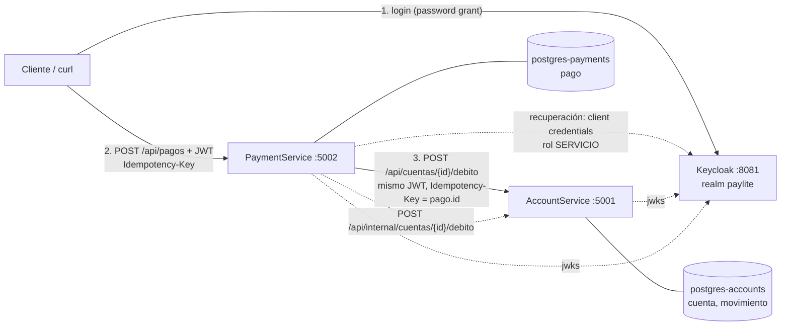

# PayLite (.NET 10)

Sistema de pagos de práctica: un usuario autenticado paga desde su cuenta con distintos métodos
(tarjeta, transferencia, billetera). Dos microservicios, cada uno con su propia base PostgreSQL,
y Keycloak como servidor de identidad.

Es la versión .NET de PayLite. Usa los mismos nombres de dominio que la versión Java (`Cuenta`, `Pago`,
`saldo`, `monto`, `metodo`) para poder comparar ambas.



| Servicio | Responsabilidad | Puerto | Base |
|---|---|---|---|
| AccountService | Cuentas, saldo, débitos y créditos idempotentes | 5001 | `accounts` (5433) |
| PaymentService | Pagos: método (Strategy), comisión, límite, llamada a cuentas, recuperación | 5002 | `payments` (5434) |
| Keycloak 26 | Emite los JWT (realm `paylite`) | 8081 | `keycloak` (interna) |

Sin claves foráneas ni tablas compartidas entre servicios: solo se hablan por HTTP.

## Cómo levantarlo

Requisitos: Docker con Compose; para desarrollar, el **SDK de .NET 10**.

**Todo en contenedores:**

```bash
docker compose --profile apps up -d --build
```

**Infraestructura en Docker y servicios desde el IDE o la terminal** (más cómodo para depurar):

```bash
docker compose up -d
```

```bash
dotnet run --project src/AccountService
```

```bash
dotnet run --project src/PaymentService
```

En `Development` cada servicio aplica sus migraciones al arrancar (`Database:MigrateOnStartup`).
Keycloak tarda unos 20–30 s en estar listo la primera vez, mientras importa el realm.

### Usuarios de prueba (solo desarrollo)

| Usuario | Contraseña | Roles |
|---|---|---|
| `cliente1` | `cliente1-dev` | CLIENTE |
| `cliente2` | `cliente2-dev` | CLIENTE |
| `admin` | `admin-dev` | ADMIN, CLIENTE |
| client `payment-service` | secret `payment-service-dev-secret` | SERVICIO (service account) |

Consola de Keycloak: http://localhost:8081, usuario `kcadmin`, contraseña `kcadmin-dev`.
Todas estas contraseñas son de desarrollo y no se reutilizan en ningún otro entorno.

## Probarlo con curl

```bash
TOKEN=$(curl -s http://localhost:8081/realms/paylite/protocol/openid-connect/token \
  -d grant_type=password -d client_id=paylite-test \
  -d username=cliente1 -d password=cliente1-dev | jq -r .access_token)
```

```bash
ADMIN=$(curl -s http://localhost:8081/realms/paylite/protocol/openid-connect/token \
  -d grant_type=password -d client_id=paylite-test \
  -d username=admin -d password=admin-dev | jq -r .access_token)
```

Crear una cuenta (nace con saldo 0):

```bash
CUENTA=$(curl -s -H "Authorization: Bearer $TOKEN" -H 'Content-Type: application/json' \
  -d '{"moneda":"DOP"}' http://localhost:5001/api/cuentas | jq -r .id)
```

Darle saldo como ADMIN:

```bash
curl -s -H "Authorization: Bearer $ADMIN" -H 'Content-Type: application/json' \
  -d '{"monto":1000}' http://localhost:5001/api/admin/cuentas/$CUENTA/credito
```

Pagar. Si repites el mismo comando, devuelve el mismo pago con `200` y `Idempotent-Replayed: true`, y no cobra otra vez:

```bash
curl -i -H "Authorization: Bearer $TOKEN" -H 'Content-Type: application/json' \
  -H 'Idempotency-Key: compra-001' \
  -d "{\"cuentaId\":\"$CUENTA\",\"monto\":100.00,\"metodo\":\"TARJETA\"}" \
  http://localhost:5002/api/pagos
```

Ver el saldo (1000 − 102.90 = 897.10):

```bash
curl -s -H "Authorization: Bearer $TOKEN" http://localhost:5001/api/cuentas/$CUENTA
```

### Prueba de humo

`scripts/smoke.sh` recorre todo el contrato con curl y jq. Comprueba estos casos:
- 401 sin token o con token inválido; 403 con rol insuficiente; 404 sobre una cuenta o un pago ajeno.
- Crédito ADMIN, pago aprobado con la comisión correcta, replay sin doble cobro y 409 con la clave reutilizada.
- 422 por límite, 400 por método desconocido, monto inválido o falta de `Idempotency-Key`, y saldo insuficiente → RECHAZADO.

```bash
./scripts/smoke.sh
```

### Recuperación de pagos PENDIENTE

```bash
docker compose stop account-service
```

Un pago ahora responde `503` con el `pagoId`, y el pago queda `PENDIENTE`:

```bash
curl -s -H "Authorization: Bearer $TOKEN" -H 'Content-Type: application/json' \
  -H 'Idempotency-Key: compra-002' \
  -d "{\"cuentaId\":\"$CUENTA\",\"monto\":50.00,\"metodo\":\"BILLETERA\"}" \
  http://localhost:5002/api/pagos
```

```bash
docker compose start account-service
```

En unos 15–25 s la recuperación lo reintenta con el mismo id y lo deja `APROBADO`. Para verlo, repite el POST con
la misma clave o consulta `GET /api/pagos/{pagoId}`.

## Endpoints

### AccountService (`:5001`)

| Método y ruta | Quién | Qué hace |
|---|---|---|
| `POST /api/cuentas` `{moneda}` | autenticado | Crea una cuenta del usuario del token → `201` |
| `GET /api/cuentas` | dueño | Sus cuentas |
| `GET /api/cuentas/{id}` | dueño | La cuenta, o `404` |
| `POST /api/cuentas/{id}/debito` `{monto}` + `Idempotency-Key` | dueño | Débito idempotente |
| `GET /api/admin/cuentas?pagina&tamano` | `ADMIN` | Todas las cuentas, paginado |
| `POST /api/admin/cuentas/{id}/credito` `{monto}` (`Idempotency-Key` opcional) | `ADMIN` | Da saldo para pruebas |
| `POST /api/internal/cuentas/{id}/debito` `{monto, ownerId}` + `Idempotency-Key` | `SERVICIO` | Débito de la recuperación |

### PaymentService (`:5002`)

| Método y ruta | Quién | Qué hace |
|---|---|---|
| `POST /api/pagos` `{cuentaId, monto, metodo}` + `Idempotency-Key` | autenticado | Procesa un pago → `201`; replay → `200` |
| `GET /api/pagos/{id}` | dueño | Un pago propio, o `404` |
| `GET /api/pagos?pagina&tamano` | dueño | Sus pagos, paginado |
| `GET /api/admin/pagos?estado&pagina&tamano` | `ADMIN` | Todos los pagos (por ejemplo `?estado=REVISION_MANUAL`) |

Todos tienen `GET /health` sin autenticación.

## Códigos de error

Todos los errores son `application/problem+json` (RFC 9457) con `title`, `detail` y `traceId`.

| Situación | Código |
|---|---|
| Sin token, vencido, firma, emisor o audiencia inválidos | `401` |
| Rol insuficiente (`CLIENTE` en `/api/admin/**`, sin `SERVICIO` en `/api/internal/**`) | `403` |
| Cuenta o pago inexistente **o ajeno** (mismo código: no se confirma que exista) | `404` |
| Entrada inválida: moneda mal formada, monto ≤ 0 o con más de 2 decimales, método desconocido, falta `Idempotency-Key` | `400` |
| `Idempotency-Key` reutilizada con otros datos; conflicto de concurrencia tras 3 reintentos | `409` |
| Saldo insuficiente (en AccountService), límite del método superado | `422` |
| AccountService responde 5xx u otra respuesta inesperada | `502` (pago `PENDIENTE`, incluye `pagoId`) |
| AccountService caído o con el circuito abierto | `503` (pago `PENDIENTE`, incluye `pagoId`) |
| AccountService no responde a tiempo | `504` (pago `PENDIENTE`, incluye `pagoId`) |
| Error no previsto | `500`, sin detalles internos (el stack trace solo va al log) |

## Decisiones de diseño

| Decisión | Por qué |
|---|---|
| **Redondeo comercial** `Math.Round(x, 2, MidpointRounding.AwayFromZero)` | El `Math.Round` de .NET redondea por defecto al par (bancario: 0.125 → 0.12). En un recibo se espera que 0.005 suba. Está probado en `MetodosPagoTests`. |
| Se debita `monto + comision` | Lo pide el contrato. La comisión se calcula una vez, al crear el pago, y queda guardada. |
| Un pago rechazado responde **`201`**, no `422` | El pago **se creó**: el rechazo es su resultado y queda consultable. `422` se reserva para lo que impide crearlo (el límite). |
| Pago `PENDIENTE` **antes** de llamar a AccountService | Si el proceso muere a mitad, queda rastro para la recuperación. |
| `Idempotency-Key` del débito = **id del pago** | Reintentar (Polly, recuperación, replay) siempre manda la misma clave. AccountService guarda `UNIQUE (cuenta_id, operacion_id)` y no cobra dos veces. |
| Reintentos HTTP con el resilience handler estándar | Timeout por intento de 2 s, total de 6 s, 2 reintentos con backoff y circuit breaker. Reintentar un POST es seguro solo porque el débito es idempotente. |
| Recuperación con **token de servicio** | El token del usuario vence a los 5 min. El client confidencial `payment-service` (rol `SERVICIO`) llama a `/api/internal/...`, que **sigue comprobando el dueño** (`ownerId` = dueño del pago). |
| `REVISION_MANUAL` tras `MaxIntentos` (5) | No se reintenta para siempre ni se marca `RECHAZADO` sin saber si el dinero salió. |
| Bloqueo optimista con `xmin` | Es una columna de sistema de PostgreSQL, sin columna extra. Dos débitos simultáneos no pierden actualizaciones: el segundo choca, relee y reintenta (máximo 3). |
| `CHECK (saldo >= 0)` en la base | Última defensa si un bug saltara la regla de la entidad. |
| Strategy + Factory con DI | Cada `IMetodoPago` se registra en DI, y `MetodoPagoFactory` recibe `IEnumerable<IMetodoPago>` y los indexa por código. Un método nuevo es una clase más, sin `switch`. |
| Migraciones de EF Core, nunca `EnsureCreated` | Esquema versionado. Una migración aplicada no se edita: `movimiento` llegó como `V2_CrearMovimiento`. El SQL revisable está en `docs/sql/`. |
| Dueño = `sub` del token | Nunca un id enviado por el cliente. Toda consulta filtra por `id` **y** `owner_id` (IDOR). |
| `MapInboundClaims = false` + `IClaimsTransformation` | Así `sub` sigue llamándose `sub`. Los roles de Keycloak vienen anidados en `realm_access.roles` y se copian a claims de rol. |

## Tests

```bash
dotnet test
```

| Proyecto | Qué cubre |
|---|---|
| `AccountService.UnitTests` | Entidad `Cuenta` (saldo, montos, moneda) y la transformación de roles de Keycloak |
| `PaymentService.UnitTests` | Cada estrategia (comisión, límite, redondeo), la factory y la entidad `Pago` |
| `AccountService.IntegrationTests` | API completa contra PostgreSQL real: 401 (vencido, firma, audiencia, emisor), 403, 404 ajena, idempotencia, débitos concurrentes, endpoint interno |
| `PaymentService.IntegrationTests` | API contra PostgreSQL real, con AccountService simulado en el `HttpMessageHandler`: replay, carrera de claves, 422 → RECHAZADO, caída/timeout/5xx → 503/504/502, recuperación y `REVISION_MANUAL` |

Los tests de integración usan **Testcontainers** (necesitan Docker). Sin Docker, apunta a un PostgreSQL
propio con permiso `CREATEDB`; cada test crea su base `acc_*` o `pay_*`:

```bash
export PAYLITE_TEST_POSTGRES="Host=localhost;Port=5432;Username=paylite;Password=paylite_dev;Database=postgres"
```

No necesitan Keycloak: firman sus JWT con una llave RSA local (`tests/Shared/TestAuth.cs`), con la misma forma que los
de Keycloak (`sub`, `aud`, `realm_access.roles`). La app valida firma, emisor, audiencia y vencimiento igual que en
producción.

Para regenerar el SQL de las migraciones:

```bash
dotnet tool restore && dotnet ef migrations script -i -p src/AccountService -o docs/sql/accounts.sql
```

## Estructura

```
PayLite.sln
docker-compose.yml           postgres x3, keycloak; servicios bajo el profile "apps"
keycloak/realm-paylite.json  realm, roles, clients, usuarios de prueba
docs/sql/                    SQL generado de las migraciones (revisable)
scripts/smoke.sh             prueba de humo con curl
src/AccountService/
  Domain/                    Cuenta, Movimiento, Montos, excepciones con su código HTTP
  Application/               CuentaService (idempotencia, reintentos de concurrencia)
  Infrastructure/            AccountDbContext, Migrations/
  Api/                       controllers, DTOs, GlobalExceptionHandler
  Security/                  JwtBearer, roles de Keycloak, ICurrentUser
src/PaymentService/
  Domain/                    Pago, Metodos/ (IMetodoPago, Tarjeta, Transferencia, Billetera, MetodoPagoFactory)
  Application/               PagoService (flujo del pago)
  Clients/                   AccountClient (HTTP + resiliencia), ServiceTokenProvider
  Recovery/                  RecuperacionPagosService (BackgroundService)
  Infrastructure/, Api/, Security/
tests/                       unit + integración por servicio; Shared/ (Postgres y JWT de prueba)
```

## Trampas conocidas

- **`iss` distinto dentro y fuera de Docker.** Si un token pedido en `localhost:8081` se valida contra `keycloak:8080`, el emisor no coincide → 401. Por eso se usa `KC_HOSTNAME=http://localhost:8081` + `KC_HOSTNAME_BACKCHANNEL_DYNAMIC=true`: el `iss` es siempre el mismo y los servicios bajan las llaves por la red interna (`Auth:MetadataAddress`).
- **Sin `MapInboundClaims = false`**, `sub` se renombra a `ClaimTypes.NameIdentifier` y `realm_access` no se encuentra.
- **Roles de Keycloak**: ASP.NET Core no entiende `realm_access.roles` sin la `IClaimsTransformation` (que además debe ser idempotente: puede ejecutarse varias veces por petición).
- **Audiencia**: Keycloak pone `aud=account` por defecto. El realm añade `paylite-api` con un *audience mapper*, y los servicios lo validan.
- **Cuenta nueva = saldo 0**: el primer débito da `422`. Usa el crédito de ADMIN.
- **`RequireHttpsMetadata`** es `true` por defecto. En `Development` y en compose se desactiva porque Keycloak corre en http.
- **`Math.Round` por defecto es bancario** (ver decisiones).
- **Registros con DataAnnotations**: en un `record` posicional, el atributo va en el parámetro (`[Required] decimal? Monto`), no con `[property: ...]`; si no, MVC lanza una excepción al validar.
